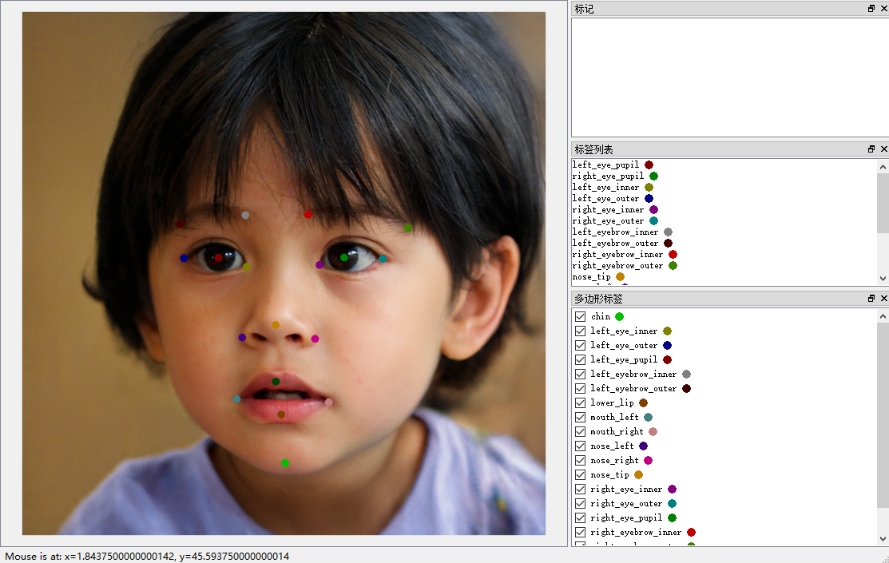
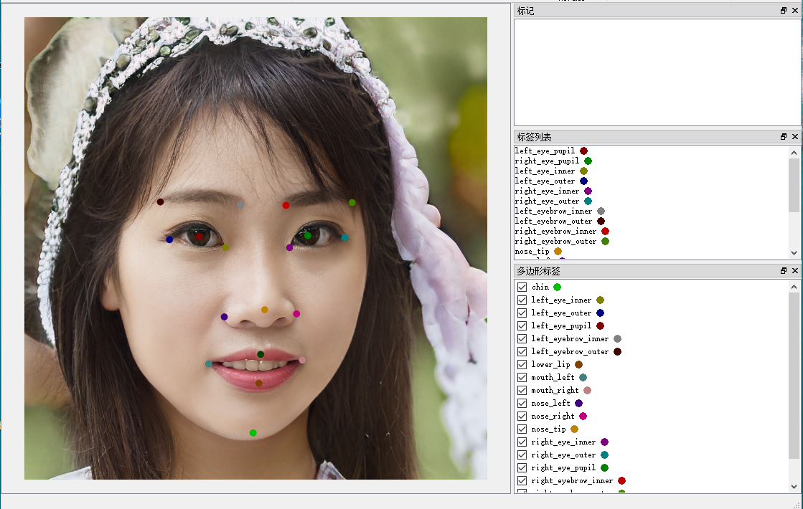
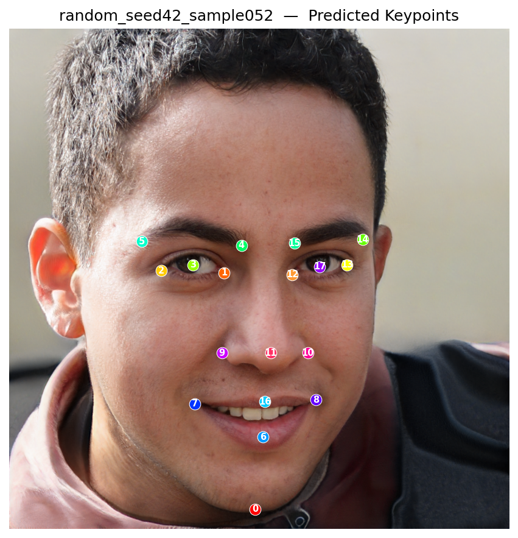
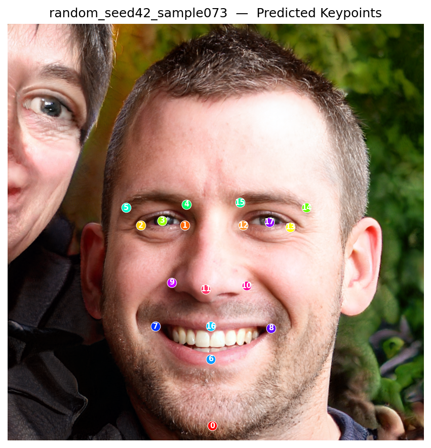
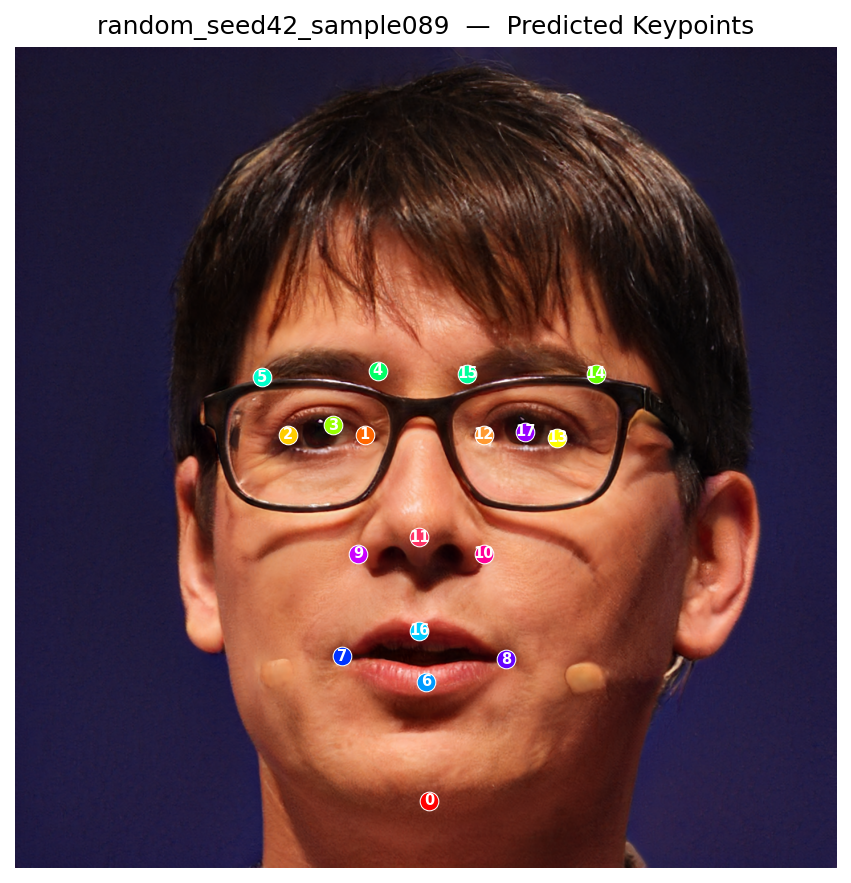
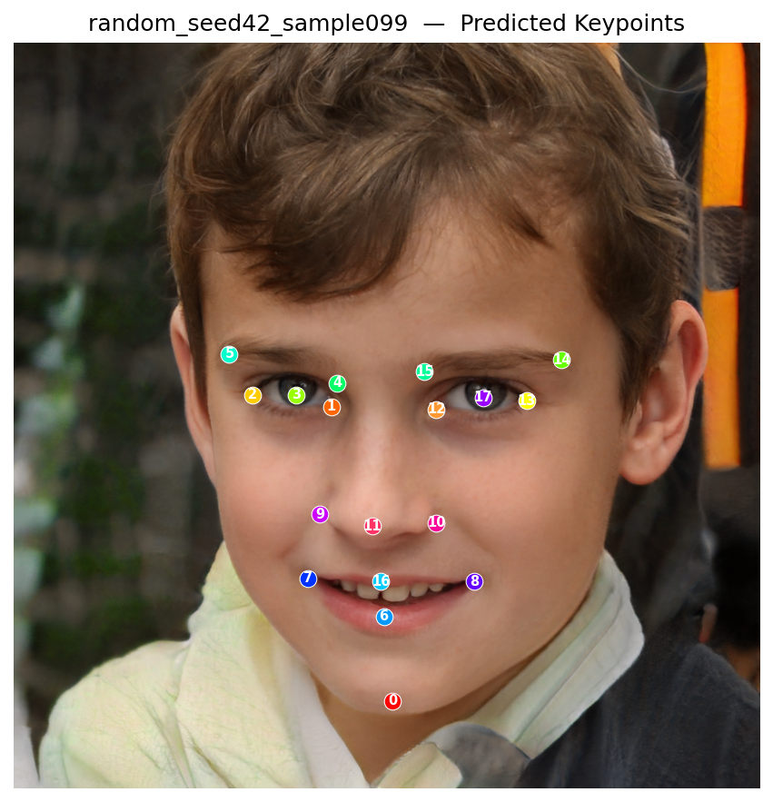

# StyleGAN2 人脸关键点自动标注

基于 StyleGAN2 的中间特征和少量人工标注，训练人脸关键点热图预测器，为生成的人脸或投影后的人脸预测 **18 个关键点**。项目思路受到 [DatasetGAN](https://arxiv.org/abs/2104.06490) 启发。

主训练入口为 [`face_keypoints/train_modular_memory_optimized.py`](face_keypoints/train_modular_memory_optimized.py)。它沿用原项目的人脸标签顺序、1024×1024 坐标体系和预测器结构，按样本提取 StyleGAN2 特征、生成热图，省去训练前保存整套高维 `features.npy` 的步骤。

仓库包含 16 张人脸及其 LabelMe 标注、旧训练权重和示例结果。运行新的训练流程仍需自行准备 **FFHQ 生成器权重、StyleGAN2 源码，以及每张训练图片的投影文件**。

## 目录与文件

```text
stylegan2-face-keypoint-annotation/
├── README.md
├── face_keypoint_annotation/
│   ├── 0.png, 2.png, ...                    # 16 张 1024×1024 人脸
│   └── keypoints_annotation/
│       └── 0.json, 2.json, ...              # 同名 LabelMe 点标注
├── face_keypoints/
│   ├── train_modular_memory_optimized.py    # 主入口：按需提取特征并训练
│   ├── inference.py                        # 随机人脸 / 已投影人脸推理
│   ├── train_keypoint_heatmap.py            # 旧入口：读取预生成 NPY
│   ├── extract_project_npy.py               # 旧流程：汇总投影 latent
│   ├── generate_FACEkeypoint_data.py        # 旧流程：特征 / 关键点预处理
│   ├── generate_heatmaps.py                 # 旧流程：预生成热图
│   ├── run_projection.sh                   # 需配置路径及 Conda 的旧投影模板
│   ├── inspect_keypoints.py
│   ├── predict_keypoints.py
│   ├── latent_ffhq.npy, keypoints.npy, heatmaps.npy
│   ├── exp_keypoint_epoch93/                # 仓库已有的旧模型与损失曲线
│   └── prediction_results/                 # 仓库已有的预测结果
├── img/                                    # 人工标注与随机生成结果示例
└── tests/                                  # 轻量回归测试
```

运行时还会使用以下文件或目录；它们不随本仓库提供：

```text
ffhq.pkl                                    # 下载到仓库根目录
stylegan2-ada-pytorch/                       # 克隆官方代码到仓库根目录
face_keypoints/projected/seed0/projected_w.npz
face_keypoints/projected/seed2/projected_w.npz
...
face_keypoints/exp_lazy_load/                # 新训练的默认输出目录
```

### 标注示例

<div align="center">
  
  
</div>

## 环境准备

先克隆本仓库，再从仓库根目录克隆 [StyleGAN2-ADA 官方实现](https://github.com/NVlabs/stylegan2-ada-pytorch)：

```bash
git clone https://github.com/V-xinzhu/stylegan2-face-keypoint-annotation.git
cd stylegan2-face-keypoint-annotation
git clone https://github.com/NVlabs/stylegan2-ada-pytorch.git
```

按官方项目的 [Requirements](https://github.com/NVlabs/stylegan2-ada-pytorch#requirements) 配置 PyTorch、CUDA 和自定义算子编译环境，再在同一环境中安装本训练脚本所用的 Python 库：

```bash
python -m pip install numpy matplotlib tqdm
```

训练依赖 `torch`、`numpy`、`matplotlib`、`tqdm`；投影和生成器加载还依赖官方项目的 `dnnlib`、`torch_utils` 及其相关依赖。`LabelMe` 用于新增人工标注，训练读取 JSON 时不需要安装它。

新训练脚本会自动选择 CUDA 或 CPU；官方投影器使用 CUDA。完整 FFHQ 特征提取占用较多资源，建议在配置好 CUDA 的环境中运行；CPU 单元测试不代表完整 FFHQ 训练已在 CPU 上验证。

下载官方 [FFHQ 权重 ffhq.pkl](https://nvlabs-fi-cdn.nvidia.com/stylegan2-ada-pytorch/pretrained/ffhq.pkl)，放到仓库根目录。**图片投影、训练特征提取和推理必须使用同一份生成器权重。** 新脚本中的默认路径由脚本所在位置定位，无需修改个人机器的硬编码路径。

## 数据格式与关键点顺序

每个样本需要三份同名前缀的数据，例如：

```text
face_keypoint_annotation/0.png
face_keypoint_annotation/keypoints_annotation/0.json
face_keypoints/projected/seed0/projected_w.npz
```

图片扫描支持 `.png`、`.jpg`、`.jpeg`，扩展名大小写均可；样本按稳定的自然顺序处理。投影目录固定采用 `seed<图片文件名前缀>` 命名，JSON 放在标注目录下的 `keypoints_annotation/` 中。

LabelMe 中使用 `shape_type: "point"`，每个样本须包含下表全部标签。训练按标签名组装坐标，与 JSON 中的排列顺序无关。

| 输出索引 | 标签 | 输出索引 | 标签 |
| --- | --- | --- | --- |
| 0 | `chin` | 9 | `nose_left` |
| 1 | `left_eye_inner` | 10 | `nose_right` |
| 2 | `left_eye_outer` | 11 | `nose_tip` |
| 3 | `left_eye_pupil` | 12 | `right_eye_inner` |
| 4 | `left_eyebrow_inner` | 13 | `right_eye_outer` |
| 5 | `left_eyebrow_outer` | 14 | `right_eyebrow_outer` |
| 6 | `lower_lip` | 15 | `right_eyebrow_inner` |
| 7 | `mouth_left` | 16 | `upper_lip` |
| 8 | `mouth_right` | 17 | `right_eye_pupil` |

当前人脸流程以 **1024×1024** 原图为基准，像素坐标 `(x, y)` 除以 `1024` 后用于生成热图。新增图片应先完成与 FFHQ 一致的裁剪、对齐和尺寸处理，再标注并投影。官方投影器会裁剪、缩放输入图像；如果投影前后坐标系改变，原始标注也必须同步变换。参见官方 [projector.py](https://github.com/NVlabs/stylegan2-ada-pytorch/blob/main/projector.py)。

`projected_w.npz` 中需要包含键 `w`，latent 的层数与维度必须匹配所用生成器。标准 FFHQ 的常见格式为 `(1, 18, 512)`；新训练脚本也接受省略首个单样本维度的 `(18, 512)`。现有 `inference.py` 不会自动补齐这一维，直接推理时应使用带 batch 维的 `(1, 18, 512)`。

## 第一步：将训练人脸投影到潜空间

以下命令从**本仓库根目录**运行，为 `0.png` 生成投影：

```bash
python stylegan2-ada-pytorch/projector.py --network=./ffhq.pkl --target=./face_keypoint_annotation/0.png --outdir=./face_keypoints/projected/seed0 --num-steps=500 --save-video=False
```

每张图的输出包括 `target.png`、`proj.png`、`projected_w.npz`。新训练脚本读取其中的 `projected_w.npz`；另外两张图片可用于人工检查重建质量。

在 **PowerShell** 中批量投影仓库现有的 16 张 PNG：

```powershell
Get-ChildItem ./face_keypoint_annotation -Filter *.png -File | ForEach-Object {
    python stylegan2-ada-pytorch/projector.py --network=./ffhq.pkl --target "$($_.FullName)" --outdir="./face_keypoints/projected/seed$($_.BaseName)" --num-steps=500 --save-video=False
    if ($LASTEXITCODE -ne 0) { throw "Projection failed: $($_.Name)" }
}
```

在 **Bash** 中执行同一流程：

```bash
for image in ./face_keypoint_annotation/*.png; do
    name=$(basename "$image" .png)
    python stylegan2-ada-pytorch/projector.py --network=./ffhq.pkl --target="$image" --outdir="./face_keypoints/projected/seed${name}" --num-steps=500 --save-video=False || break
done
```

仓库的 `face_keypoints/run_projection.sh` 保留了旧环境的目录和 Conda 占位配置；使用它前，需要修改 `cd`、Conda 初始化/激活命令、输入/输出目录和模型路径。上面的命令可直接表达本 README 使用的目录约定。

## 第二步：按需提取特征并训练

后续训练和推理示例均从 `face_keypoints` 目录运行：

```bash
cd face_keypoints
python train_modular_memory_optimized.py --help
python train_modular_memory_optimized.py --exp_dir ./exp_lazy_load --epochs 100 --batch_size 2 --lr 0.0005 --patience 50
```

该流程直接读取标注 JSON 和每张图的投影 latent，**不需要先运行** `extract_project_npy.py`、`generate_FACEkeypoint_data.py` 或 `generate_heatmaps.py`，也不依赖仓库已有的 NPY 文件。

### 命令行参数

| 参数 | 默认值 | 用途 |
| --- | --- | --- |
| `--annotation_dir` | 仓库下 `face_keypoint_annotation` | 图片目录；内部包含 `keypoints_annotation` |
| `--projected_dir` | 仓库下 `face_keypoints/projected` | 包含 `seed*/projected_w.npz` 的目录 |
| `--generator_path` | 仓库根目录 `ffhq.pkl` | FFHQ 生成器权重 |
| `--stylegan_path` | 仓库下 `stylegan2-ada-pytorch` | 官方源码目录，供导入模块使用 |
| `--exp_dir` | `./exp_lazy_load` | 训练输出目录，相对当前工作目录 |
| `--epochs` | `100` | 目标总训练轮数 |
| `--batch_size` | `2` | 每批样本数 |
| `--lr` | `0.0005` | 初始学习率 |
| `--patience` | `50` | 训练损失连续未改善时的早停轮数 |
| `--resume` | 不启用 | 断点文件路径 |

自定义数据路径示例：

```bash
python train_modular_memory_optimized.py --annotation_dir "D:/datasets/faces" --projected_dir "D:/datasets/projected" --generator_path "D:/models/ffhq.pkl" --stylegan_path "D:/projects/stylegan2-ada-pytorch" --exp_dir ./exp_custom --batch_size 1
```

这里的 `--stylegan_path` 指 **源码目录**；后文 `inference.py` 的同名参数沿用旧接口，指 **生成器 PKL 文件**。旧推理脚本默认从仓库根目录下的 `stylegan2-ada-pytorch` 导入源码；使用外部源码目录时，推理环境还需通过 `PYTHONPATH` 提供该目录。

### 训练流程与模型

1. 扫描图片，核对同名 JSON 和投影文件，加载较小的 latent 与关键点坐标。
2. 每次取样时运行固定的 StyleGAN2 生成器，Hook `b4.conv1` 及后续各分辨率的 `conv0`、`conv1` 输出。
3. 将各层特征用双线性插值统一到 `256×256` 后按通道拼接；输入通道数由实际生成器推断，标准 FFHQ 为 `5568`。
4. 按标注坐标生成 18 通道高斯热图，`sigma=10`，训练热图预测器。
5. 用训练期间保存的最佳模型，在这些已标注样本上进行复评并导出坐标。

预测器保持与旧人脸推理脚本相同的层名称和结构：

| 层 | 通道与分辨率变化 |
| --- | --- |
| 输入特征 | `(B, 5568, 256, 256)`，标准 FFHQ 配置 |
| `1×1 Conv + ReLU + BatchNorm` | `5568 → 512`，分辨率不变 |
| `3×3 Conv, stride=2 + ReLU + BatchNorm + Dropout` | `512 → 256`，`256 → 128` |
| `3×3 Conv, stride=2 + ReLU + BatchNorm + Dropout` | `256 → 128`，`128 → 64` |
| 双线性上采样 | `64 → 256`，通道数保持 `128` |
| `3×3 Conv + ReLU` | `128 → 64` |
| `1×1 Conv + Sigmoid` | `64 → 18`，输出 `(B, 18, 256, 256)` |

训练采用 MSE、Adam（`weight_decay=1e-4`）和 `ReduceLROnPlateau`（`patience=20`、`factor=0.5`），按训练损失调节学习率和早停。CUDA 上对预测器训练使用 AMP；Hook 捕获的特征转为 float32，插值与拼接沿用 float32，生成器内部精度遵循其模型配置。

按需处理减少整套特征常驻 RAM 的需求，但每轮会重新计算特征，也仍需承担单样本的显存和 CPU 副本开销。例如，`5568×256×256` 的 float32 特征本身约为 **1.36 GiB/样本**，尚未计入生成器、插值临时张量、批处理和反向传播。遇到内存不足时先尝试 `--batch_size 1`；这仍不是低显存运行保证。数据加载器保持 `num_workers=0`，避免多个进程同时运行 GPU 特征提取。

### 断点续训

```bash
python train_modular_memory_optimized.py --exp_dir ./exp_lazy_load --resume ./exp_lazy_load/best_model.pth --epochs 200 --batch_size 1
```

`--epochs 200` 表示训练到总计 200 轮。断点仅在训练损失改善时更新，恢复点为**最佳轮次**，可能早于训练中断的轮次。新检查点保存模型、优化器、学习率调度器、AMP scaler 和训练记录；旧检查点按实际包含的字段恢复，缺少的优化器等状态重新初始化。

续训应使用相同的图片、标签、生成器和特征配置。改变数据或结构后重新训练；断点不提供随机数状态的逐步复现保证。

## 第三步：查看训练结果

成功完成训练与复评后，`--exp_dir` 下包含：

| 文件 | 内容 |
| --- | --- |
| `best_model.pth` | 训练损失最佳轮次的检查点 |
| `loss_curve.png` | 训练 MSE 曲线 |
| `predicted_keypoints.npy` | `(N, 18, 2)`，按 `(x, y)` 排列的归一化坐标 |
| `evaluation_results.png` | 最多前 4 个样本的真实/预测坐标散点对比 |
| `filenames.json` | 样本前缀顺序，对应预测数组的第一个维度 |
| `training_config.json` | 本次运行的训练配置 |

关键点由每张热图的最大值位置获得，坐标为 `(x / 256, y / 256)`；乘以 `1024` 可映射回本项目原图坐标。复评输出归一化平均欧氏距离及其对应的 1024 原图像素误差。

**当前脚本对训练样本复评，没有独立验证集或测试集。** 训练损失低或训练集误差小，不能直接证明新图片上的标注精度。评估图是坐标散点图；下方推理步骤会生成叠加关键点的人脸图片。

## 第四步：自动标注新的人脸

标准 FFHQ 的 `5568` 通道特征和 18 点预测器可使用已有的 [`inference.py`](face_keypoints/inference.py)。请显式传入新模型路径，避免加载旧默认实验目录。

### 随机生成并标注

```bash
python inference.py --mode random --model_path ./exp_lazy_load/best_model.pth --stylegan_path ../ffhq.pkl --num_samples 4 --seed 42 --output_dir ./random_results
```

`--num_samples` 控制生成数量，`--seed` 控制采样，`--truncation` 默认 `0.7`。这会生成新的人脸，并在生成图像上预测关键点。

### 标注已有图片的投影结果

先按第一步将图片投影到同一 FFHQ 生成器，再运行：

```bash
# 单个投影
python inference.py --mode latent --model_path ./exp_lazy_load/best_model.pth --stylegan_path ../ffhq.pkl --latent_path ./projected/seed0/projected_w.npz --output_dir ./latent_results

# 批量处理 projected 下的直接子目录，并额外保存热图可视化
python inference.py --mode latent --model_path ./exp_lazy_load/best_model.pth --stylegan_path ../ffhq.pkl --latent_dir ./projected --output_dir ./latent_results --save_heatmaps
```

输出目录包含带关键点的 PNG、`all_keypoints.npy`；开启 `--save_heatmaps` 时还会保存热图可视化。`latent` 模式的坐标对应 **StyleGAN2 重建图像**，用于原始真实图像时应先检查重建偏差和投影前的几何变换。

现有 `inference.py` 固定使用 `5568` 输入通道。若替换生成器后训练脚本推断出的通道数不同，需同步调整推理模型结构；不能直接加载到固定的 FFHQ 推理模型中。

### 仓库原有的人脸生成示例

下图为原项目保留的示例，用于展示输出形式：

<div align="center">
  
  
  
  
</div>

## 原有 NPY 训练流程

原 `train_keypoint_heatmap.py` 仍可用于已经准备好的特征、热图和坐标数据。它们必须具有一致的样本顺序：`features.npy` 为 `(N, 5568, 256, 256)`，`heatmaps.npy` 为 `(N, 18, 256, 256)`，`keypoints.npy` 为 `(N, 18, 2)`。

```bash
python train_keypoint_heatmap.py --features features.npy --heatmaps heatmaps.npy --keypoints keypoints.npy --exp_dir ./exp_keypoint --epochs 100 --batch_size 2 --lr 0.001
```

仓库没有提供 `features.npy`。`generate_FACEkeypoint_data.py` 的默认入口只生成关键点；要走完整旧预处理流程，需要显式启用 `prepare_keypoint_data(featuresmap=True, keypoints=True)`，并先重新汇总投影 latent，确保传入生成器的单样本带有 batch 维。新训练入口无需这些中间步骤。

仓库中的 `exp_keypoint_epoch93/best_model.pth` 和 `prediction_results/` 属于原流程。复用已有权重做推理时，可以把 `--model_path` 改为 `./exp_keypoint_epoch93/best_model.pth`。旧结果中的像素误差需要核对采用的是 256 热图尺寸还是 1024 原图尺寸，不应作为新脚本的实测结果。

## 检查与常见问题

从仓库根目录运行轻量回归测试：

```bash
python -B -m unittest discover -s tests -v
```

轻量验证环境为 Python 3.13.2、PyTorch 2.7.1+cu126，测试运行在 CPU。测试使用仓库标注和小型替身生成器验证数据配对、热图、预测器兼容性与训练状态；不下载 FFHQ 权重，也不替代完整 FFHQ GPU 训练。

| 现象 | 检查方式 |
| --- | --- |
| 找不到 `projected_w.npz` | 每张图片都应有 `projected/seed<前缀>/projected_w.npz`；检查 `--projected_dir` |
| 缺失或重复关键点标签 | 核对 LabelMe 的 18 个标签名和 `shape_type: point` |
| 找不到 `dnnlib` / `torch_utils` | `--stylegan_path` 应指向完整的官方源码目录 |
| CUDA 自定义算子编译失败 | 按官方要求检查 CUDA toolkit、编译器和 PyTorch 环境 |
| RAM / CUDA 内存不足 | 减小 batch size，确认内存预算；按需处理仍有较大单样本开销 |
| 模型加载时尺寸不匹配 | 检查生成器、输入通道数和 18 点结构是否与权重一致 |
| 续训文件不存在 | 检查 `--resume` 指向的真实检查点路径 |

## 致谢与引用

感谢 DatasetGAN 提出的少量标注与生成模型结合的数据生成思路，以及 NVIDIA 提供的 StyleGAN2-ADA 实现和预训练模型。

```bibtex
@inproceedings{zhang2021datasetgan,
  title={Datasetgan: Efficient labeled data factory with minimal human effort},
  author={Zhang, Yuxuan and Ling, Huan and Gao, Jun and Yin, Kangxue and Lafleche, Jean-Francois and Barriuso, Adela and Torralba, Antonio and Fidler, Sanja},
  booktitle={Proceedings of the IEEE/CVF Conference on Computer Vision and Pattern Recognition},
  pages={10145--10155},
  year={2021}
}

@inproceedings{Karras2020ada,
  title={Training Generative Adversarial Networks with Limited Data},
  author={Tero Karras and Miika Aittala and Janne Hellsten and Samuli Laine and Jaakko Lehtinen and Timo Aila},
  booktitle={Proc. NeurIPS},
  year={2020}
}
```
